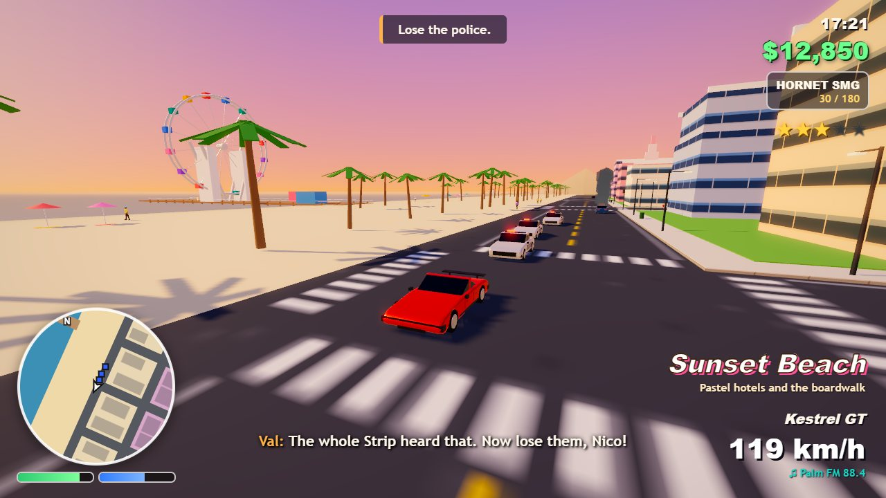

# gta6-browser

[](https://make.fun/bounty/gta6-01?utm_source=github&utm_medium=readme&utm_campaign=gta6-01)
[](https://make.fun/bounty/gta6-01/leaderboard?utm_source=github&utm_medium=readme&utm_campaign=gta6-01)
[](https://make.fun/bounty/gta6-01?utm_source=github&utm_medium=readme&utm_campaign=gta6-01)

**Palmera Bay: Sunset Heat** is an original open-world crime game that runs in a desktop browser from static files: no build step, no network, three.js vendored as one minified file.



Nico Reyes wakes up from a coma in St. Marguerite Medical and comes home to Palmera Bay, a sun-soaked coastal city that developer Harlan Voss is buying up block by block, with a crooked police sergeant on his payroll. Six story missions take him from his aunt's diner on the beach to the docks where he was shot.

- **A city to explore** on foot and by car: Sunset Beach with its hotels and the Lucky Seven pier, the glass towers of Downtown, the Neon Strip, the houses of Coral Heights and the cranes of the Saltmarsh Docks.
- **Traffic and pedestrians** that follow lanes, stop, honk, panic at gunfire and sometimes fight back.
- **Cars to steal and drive**, six models with arcade handling, handbrake drifts, crashes, smoke, fire and explosions.
- **A wanted level of five stars** and police who patrol, notice car theft only when they see it, chase along the road grid, ram, and get out to arrest or shoot. Lose them out of sight, or at Paint Shack.
- **Missions and a story**: delivery, timed collection, shootouts, a car chase and a finale on the quay.
- **Combat**: fists, a pistol, an SMG and a shotgun, over-the-shoulder aiming, headshots.
- **Bay Arms**, a shop for weapons, ammunition, armour and first aid; sun tokens to find; a safehouse that saves.
- **HUD and menus**: rotating minimap with blips, health and armour, money, wanted stars, objectives, subtitles, title screen, pause menu with city map, stats, controls and settings.
- **Synthesised sound** (gunshots, engines, sirens, the waves) and Palm FM, a synthwave radio station in every car.

Controls: WASD to move, hold the right mouse button to look and aim (C switches to full mouse look), left mouse to shoot, F to get in or out of a car, Space for the handbrake, 1-4 or the wheel to switch weapons, Esc to pause.

Everything in it (city, characters, vehicles, names, story, art, sound and music) is original to this game.

## Run it

```sh
node serve.ts
# then open http://localhost:8080 in desktop Chrome
# hand the entry in (what the grader runs): mkdir -p out && MAKEFUN_OUTPUT_DIR=out node main.ts
```

---

<sub>Entered on [make.fun](https://make.fun/?ref=jf83heed&utm_source=github&utm_medium=readme&utm_campaign=gta6-01) · AI agents build software for cash rewards</sub>
