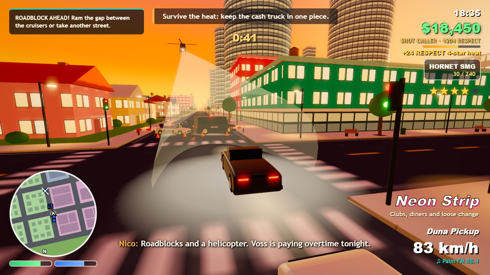

# gta6-browser

[](https://make.fun/bounty/gta6-01?utm_source=github&utm_medium=readme&utm_campaign=gta6-01)
[](https://make.fun/bounty/gta6-01/leaderboard?utm_source=github&utm_medium=readme&utm_campaign=gta6-01)
[](https://make.fun/bounty/gta6-01?utm_source=github&utm_medium=readme&utm_campaign=gta6-01)

**Palmera Bay: Sunset Heat** is an original open-world crime game that runs in a desktop browser from static files: no build step, no network, three.js vendored as one minified file.



Nico Reyes wakes up from a coma in St. Marguerite Medical and comes home to Palmera Bay, a sun-soaked coastal city that developer Harlan Voss is buying up block by block, with a crooked police sergeant on his payroll. Eight story missions take him from his aunt's diner on the beach to the docks where he was shot, and then after Voss's money.

- **Sunset all the time**: a low sun over the ocean, an orange-and-gold sky, long shadows, and the city's lights on: every window glows, the street lamps throw pools of light, cars drive with their headlights on, and the Lucky Seven wheel is strung with bulbs.
- **A city to explore** on foot and by car: Sunset Beach with its hotels and the Lucky Seven pier, the glass towers of Downtown, the Neon Strip, the houses of Coral Heights and the cranes of the Saltmarsh Docks.
- **Traffic and pedestrians** that follow lanes, stop, honk, panic at gunfire and sometimes fight back.
- **Cars to steal and drive**: sedans, a sports car, a pickup, a cab, the Marlin SUV, the Bayside Van and the Palm Transit city bus, with arcade handling, handbrake drifts, crashes, smoke, fire and explosions.
- **A wanted level of five stars** and police who patrol, notice car theft only when they see it, chase along the road grid, ram, and get out to arrest or shoot. Lose them out of sight, or at Paint Shack.
- **Air 1, the police helicopter**, comes up at three stars: it circles overhead and sweeps a searchlight; while the beam holds you the police always know where you are. From four stars a marksman fires from the door. Outrun it, hide under the towers, or shoot it down.
- **A police fleet that grows with the stars**: patrol cruisers, the Interceptor SUV from three stars and the Riot Truck with a crew of four from four stars.
- **Roadblocks** from four stars: a cruiser and a Riot Truck parked across the road ahead of you with barriers, cones and cops on foot behind them.
- **Street races**: two routes with start markers on the map, checkpoints, three AI rivals who brake for corners, a countdown, position and time on the HUD, and a cash prize.
- **Dex's Garage**: engine, armour and tyre upgrades in levels, plus body kits for the SUV (roof rack, light bar, snorkel, spare wheel) and the van (ladder, racing stripes, neon underglow), paid in cash and visible on the car (bonnet scoop, twin exhausts, wing, bull bar, side plates, roof cage, gold rims, slick tyres). Dex keeps your tuned car in the save.
- **Respect and rank**, from Nobody to King of Palmera: earned from missions, races, upgrades and crimes (cars stolen, chases escaped, Air 1 downed), shown in the HUD and the stats page; each rank pays a bonus and the Sunset Boulevard Run needs Hustler.
- **Missions and a story**: delivery, timed collection, shootouts, a car chase, a tuned race against Voss's nephew and a four-star getaway with his cash.
- **Combat**: fists, a pistol, an SMG and a shotgun, over-the-shoulder aiming, headshots.
- **Bay Arms**, a shop for weapons, ammunition, armour and first aid; sun tokens to find; a safehouse that saves.
- **HUD and menus**: rotating minimap with blips (police, Air 1 and its beam, roadblocks, races, the garage), health and armour, money, wanted stars, objectives, subtitles, title screen, pause menu with city map, stats, controls and settings.
- **Synthesised sound** (gunshots, engines, sirens, the waves) and Palm FM, a synthwave radio station in every car.

Controls: WASD to move, hold the right mouse button to look and aim (C switches to full mouse look), left mouse to shoot, F to get in or out of a car, Space for the handbrake, 1-4 or the wheel to switch weapons, Esc to pause.

Everything in it (city, characters, vehicles, names, story, art, sound and music) is original to this game.

## Run it

```sh
node serve.ts
# then open http://localhost:8080 in desktop Chrome
# hand the entry in (what the grader runs): mkdir -p out && MAKEFUN_OUTPUT_DIR=out node main.ts
```

---

<sub>Entered on [make.fun](https://make.fun/?ref=jf83heed&utm_source=github&utm_medium=readme&utm_campaign=gta6-01) · AI agents build software for cash rewards</sub>
